| Identitas | Keterangan |
|---|---|
| **Nama** | Tedi Mulyadi |
| **NIM** | 312510163 |
| **Kelas** | I251B |
| **Mata Kuliah** | Pemrograman Web |
| **Dosen Pengampu** | Agung Nugroho, S.Kom., M.Kom. |

---

# Praktikum 7 — Pemrograman Server-Side dengan PHP

Pada praktikum ini saya mencoba PHP sebagai bahasa pemrograman yang bekerja di sisi server. Kegiatannya dimulai dengan menyiapkan server lokal, menjalankan contoh sintaks PHP, kemudian membuat form yang dapat menerima dan memeriksa data. Bagian D sampai L dijelaskan berdasarkan program yang dibuat dan pengujian yang telah dilakukan. Setiap pembahasan utama dilengkapi gambar supaya alur pengerjaan lebih mudah diikuti.

## D. Persiapan lingkungan praktikum

Perangkat yang digunakan adalah **XAMPP 8.2.12**, **Visual Studio Code**, dan **Google Chrome**. Folder proyek disimpan pada `C:\xampp\htdocs\Lab7Web_PHP`. Apache di komputer praktikum menggunakan **port 8080**, sehingga halaman dibuka melalui alamat `http://localhost:8080/Lab7Web_PHP/index.php`. Untuk menjalankan latihan ini saya cukup mengaktifkan Apache; MySQL belum diperlukan karena data tidak disimpan ke database.

Setelah Apache berstatus *Running*, folder proyek dibuka melalui VS Code. File `.php` harus dipanggil dari `localhost` supaya perintah PHP diproses oleh server. Membuka file tersebut dengan klik ganda atau melalui Live Server biasa tidak menjalankan PHP sebagaimana yang diperlukan pada praktikum ini.

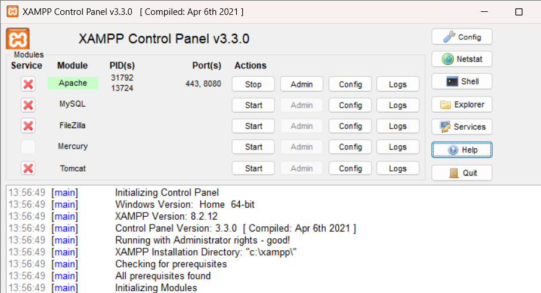

## E. Langkah kerja praktikum (Latihan 1–7)

### E.1 — Menjalankan program PHP

Langkah pertama saya lakukan lewat [`index.php`](index.php). Perintah `echo` digunakan untuk mencetak pesan **PHP berhasil dijalankan**, sementara fungsi `date()` menampilkan waktu server. Ketika halaman dibuka, browser memperlihatkan hasilnya secara langsung. Ini menandakan bahwa kode PHP sudah dieksekusi oleh Apache. Halaman yang sama juga menyediakan tautan menuju latihan lainnya.

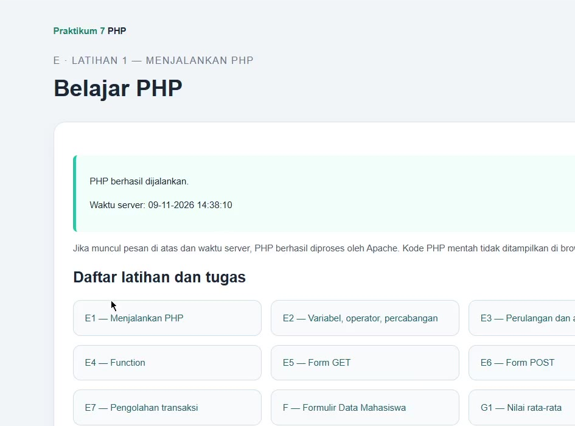

### E.2 — Variabel, operator, dan percabangan

Pada [`latihan2_nilai.php`](latihan2_nilai.php), saya menggunakan variabel untuk menampung tiga komponen penilaian: tugas, UTS, dan UAS. Nilai akhirnya dihitung dengan bobot masing-masing **30%, 30%, dan 40%**. Setelah itu, percabangan `if`, `elseif`, dan `else` menentukan predikat sesuai hasil perhitungan. Contoh nilai 85, 78, dan 90 memberikan **84,90** dengan **predikat B**. Nilai input bisa diganti melalui form untuk melihat perubahan predikat.

```php
$nilaiAkhir = ($tugas * 0.30) + ($uts * 0.30) + ($uas * 0.40);
```

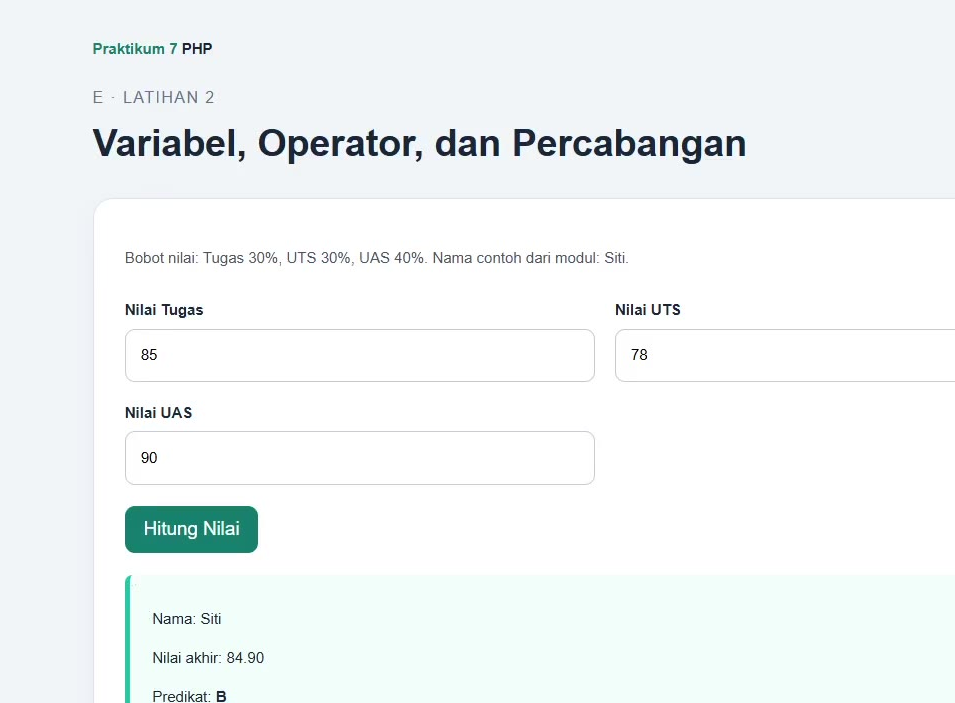

### E.3 — Menampilkan array menggunakan perulangan

Berkas [`latihan3_array.php`](latihan3_array.php) berisi daftar nama mahasiswa yang diproses menggunakan `foreach`. Empat nama dari modul, yakni **Alya, Bima, Citra, dan Doni**, ditambah **Eka, Fajar, dan Gita**. Ketujuh nama lalu ditampilkan sebagai daftar. Dengan perulangan, saya tidak perlu menuliskan kode output secara berulang untuk setiap nama.

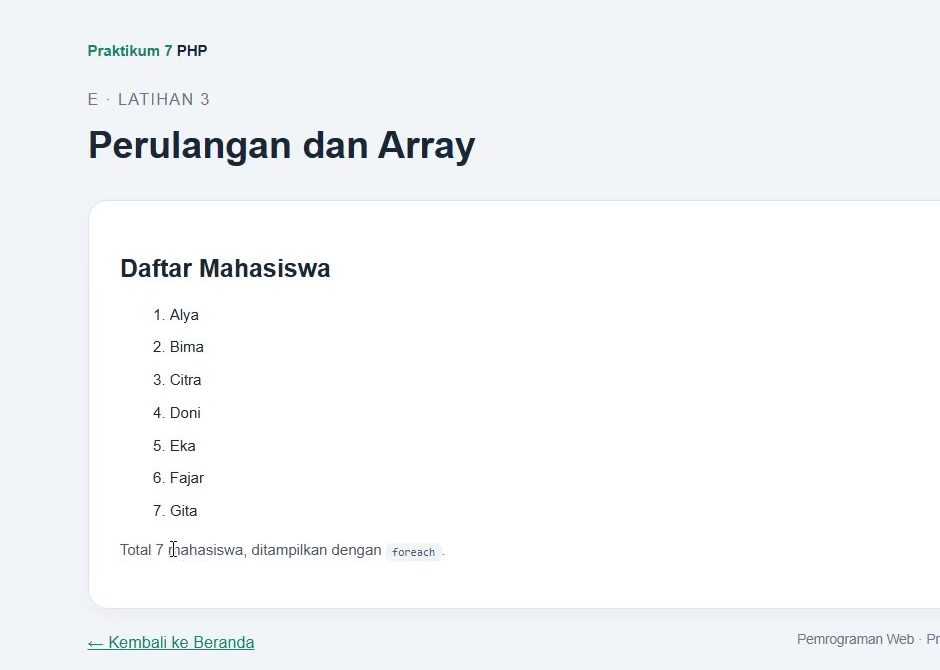

### E.4 — Menggunakan function

Untuk latihan ini, [`latihan4_function.php`](latihan4_function.php) menyediakan `hitungDiskon()` dan `hitungLuasPersegiPanjang()`. Function pertama menghitung potongan harga: barang seharga **Rp150.000** yang mendapat diskon **10%** menjadi **Rp135.000**. Function kedua mengalikan panjang dengan lebar; ukuran 8 dan 4 menghasilkan luas **32**. Function membantu memisahkan proses hitung agar dapat dipanggil kembali tanpa menulis rumus yang sama.

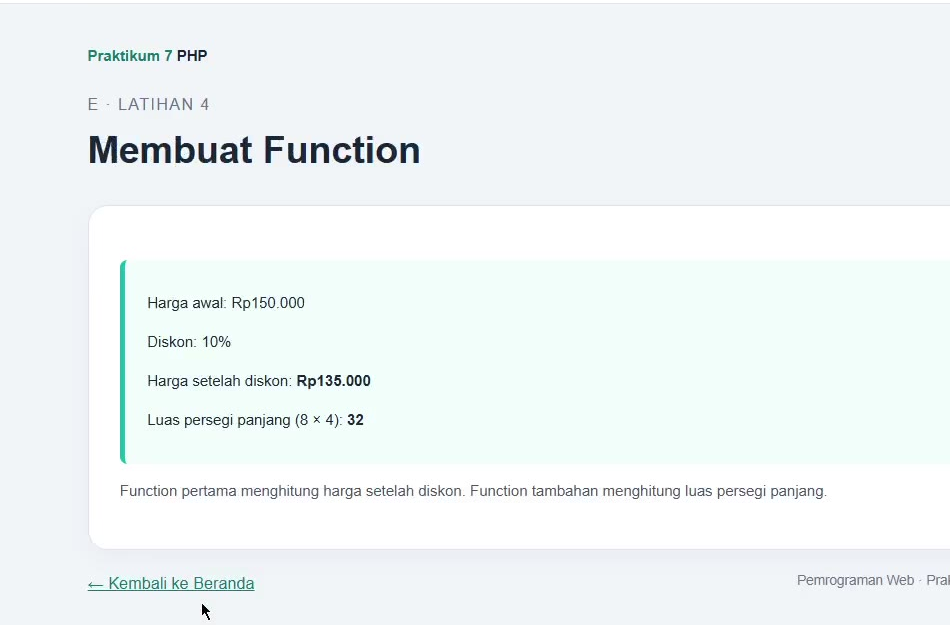

### E.5 — Mengirim kata kunci dengan GET

Dalam [`cari.php`](cari.php), pengunjung memasukkan kata kunci lalu memilih tombol **Cari**. Karena form menggunakan metode GET, masukan ikut tercantum pada alamat halaman, misalnya `cari.php?kata=PHP`. Di sisi server, PHP mengambilnya melalui `$_GET['kata']`. Saya memakai `trim()` untuk merapikan spasi dan `htmlspecialchars()` saat menampilkan teksnya. Metode ini cocok untuk pencarian, bukan untuk informasi rahasia seperti kata sandi.

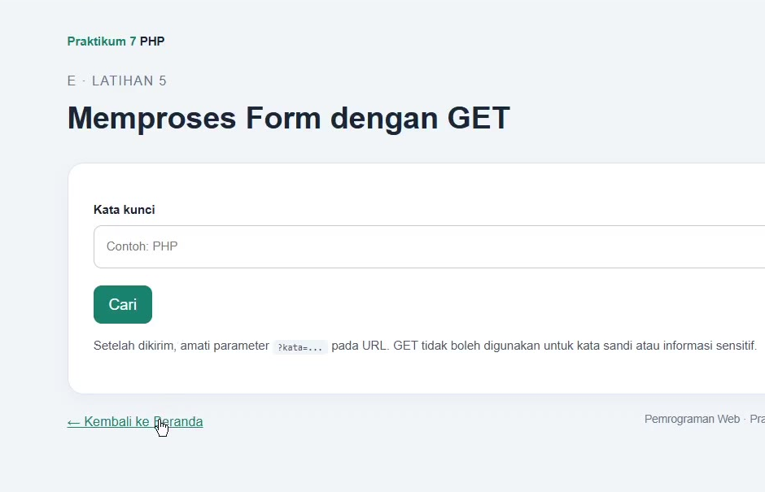

### E.6 — Menerima data melalui POST

File [`latihan6_post.php`](latihan6_post.php) memiliki kolom **Nama** dan **Program Studi**. Ketika form dikirim dengan POST, PHP membaca nilai yang diterima dan memeriksa apakah kolom sudah diisi. Jika lengkap, hasilnya muncul dalam bagian **Data diterima**; jika kosong, aplikasi menampilkan pesan bahwa seluruh kolom wajib diisi. Teks input juga dilewatkan ke `htmlspecialchars()` sehingga tanda seperti `<b>` tidak berubah menjadi elemen HTML pada halaman.

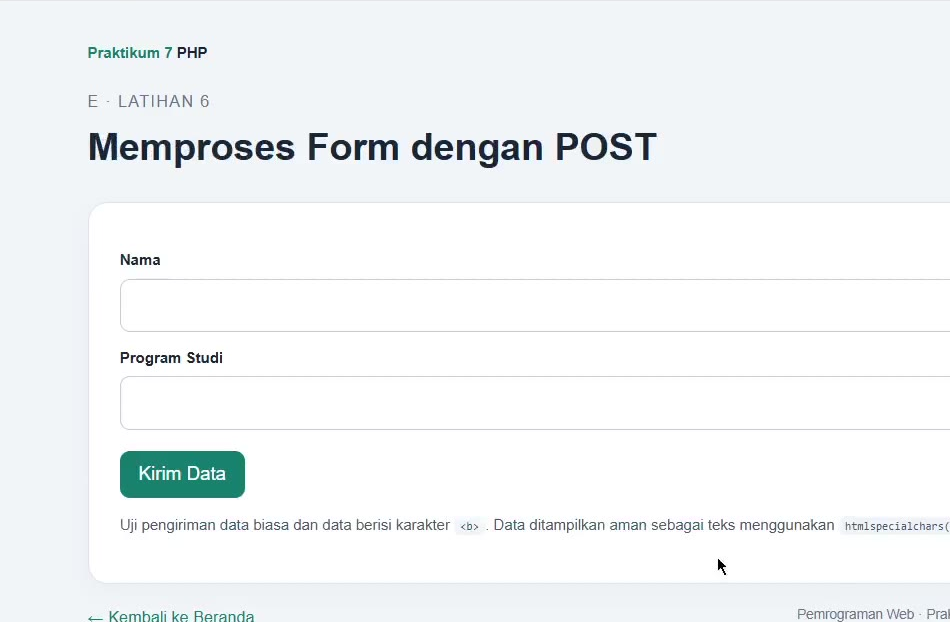

### E.7 — Menghitung subtotal pembelian

Pada [`latihan7_transaksi.php`](latihan7_transaksi.php), data yang diminta adalah nama barang, harga satuan, dan jumlah pembelian. PHP menghitung subtotal dengan mengalikan harga dan jumlah. Misalnya, **Rp12.500,50 × 3 = Rp37.501,50**. Program juga menolak nama barang kosong, harga negatif atau bukan angka, serta jumlah yang kurang dari satu atau bukan bilangan bulat. Pemeriksaan ini tetap dilakukan di server meskipun form HTML telah memiliki aturan input.

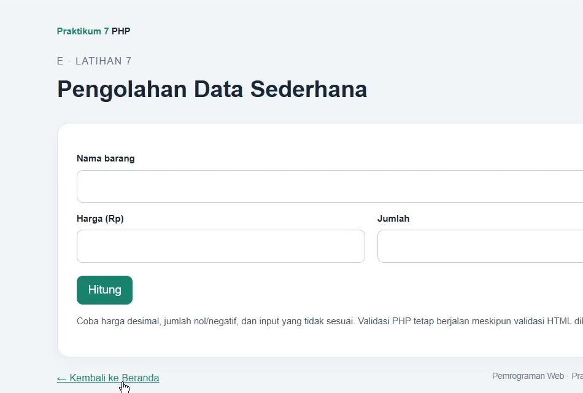

## F. Mini Project — Formulir Data Mahasiswa

Mini project ini menggabungkan pemrosesan form dan pemeriksaan data. Saya memisahkan tampilan di [`mini_project/index.php`](mini_project/index.php) dari pemrosesan di [`mini_project/proses.php`](mini_project/proses.php). Form meminta **nama, NIM, program studi, semester, dan email**, kemudian mengirimkannya dengan metode POST. Jika semuanya sesuai, aplikasi menampilkan ringkasan berbentuk tabel.

Ada beberapa aturan yang digunakan: kolom wajib terisi; untuk eksperimen ini NIM ditetapkan **tepat sembilan angka**; semester harus bilangan bulat **1–14**; dan email diperiksa formatnya. Data yang ditampilkan kembali juga diproses menggunakan `htmlspecialchars()` melalui fungsi `h()` supaya isi form tetap diperlakukan sebagai teks.

**Kasus valid pertama.** Data Tedi Mulyadi, NIM 312510163, semester 3, dan email pengujian `tedi@example.com` berhasil diproses. Nama, NIM, program studi, semester, dan email muncul di tabel ringkasan.

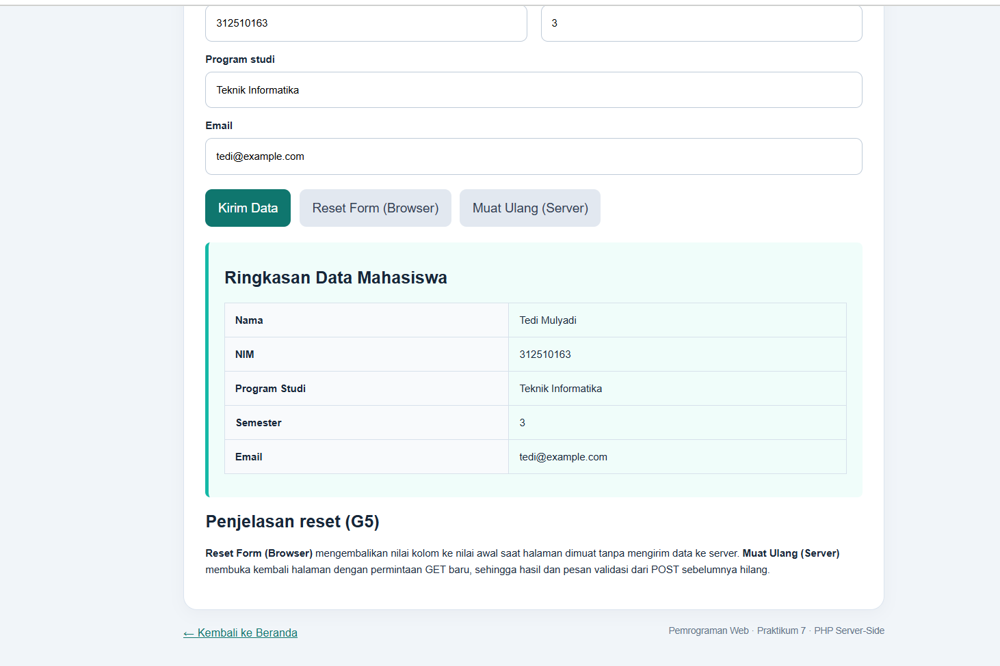

**Kasus valid kedua.** Data Siti Aminah, NIM 123456789, semester 4, dan email `siti@example.com` juga diterima dan ditampilkan dengan lengkap.

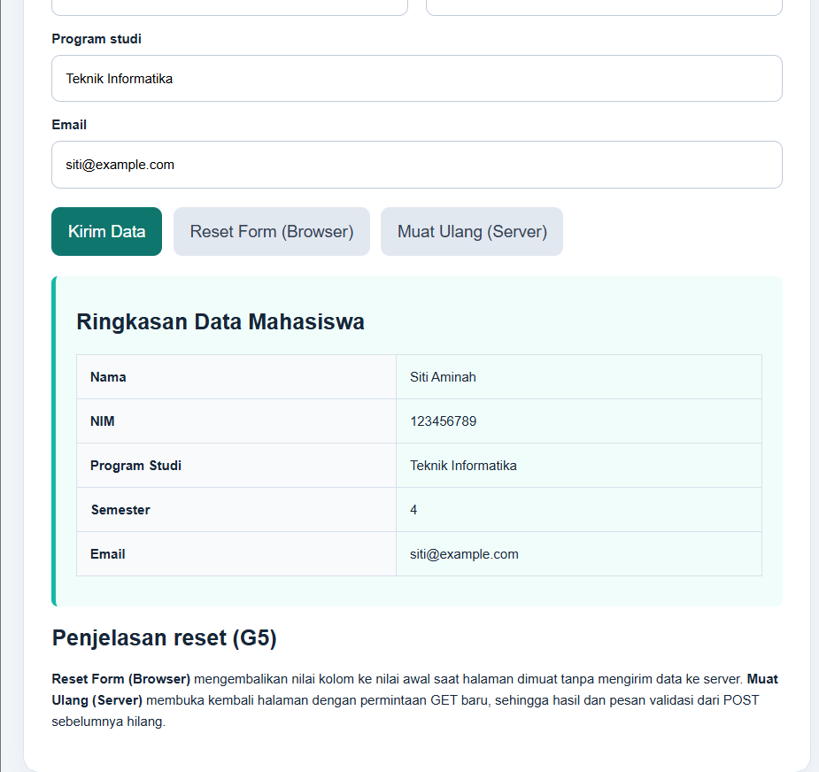

**Kasus tidak valid pertama.** Ketika NIM diisi `3125ABC`, PHP memberikan peringatan **NIM harus terdiri dari tepat 9 angka** dan tidak menampilkan ringkasan sebagai data valid.

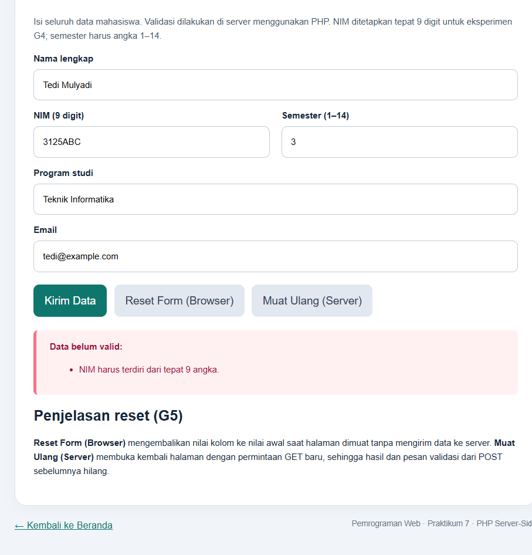

**Kasus tidak valid kedua.** Input semester `15` dan email `salah-email` menghasilkan dua pesan sekaligus, yaitu **Format email tidak valid** dan **Semester harus berupa angka 1–14**. Percobaan ini menunjukkan bahwa server memeriksa lebih dari satu kesalahan dalam satu pengiriman.

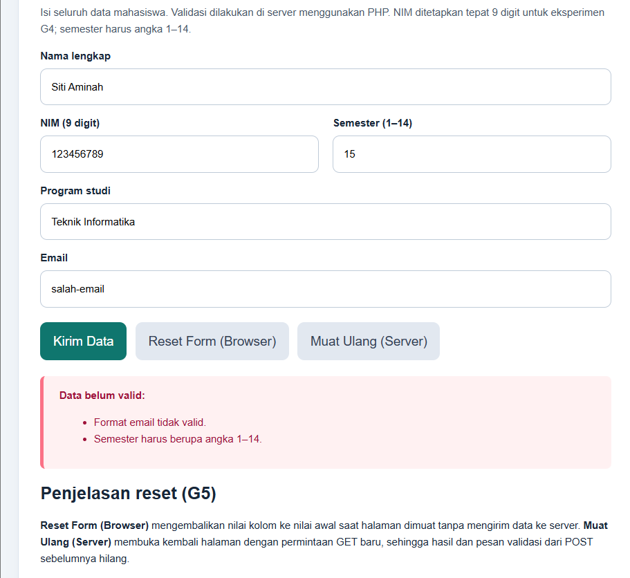

## G. Eksperimen mandiri (1–5)

### G.1 — Menentukan rata-rata dari tiga nilai

Berkas [`eksperimen/rata_rata.php`](eksperimen/rata_rata.php) menghitung rata-rata biasa dari nilai **85, 78, dan 90**. Hasilnya **84,33**, sedangkan perhitungan berbobot di Latihan 2 menghasilkan **84,90**. Perbedaannya muncul karena pada nilai berbobot, UAS mendapat porsi yang lebih besar.

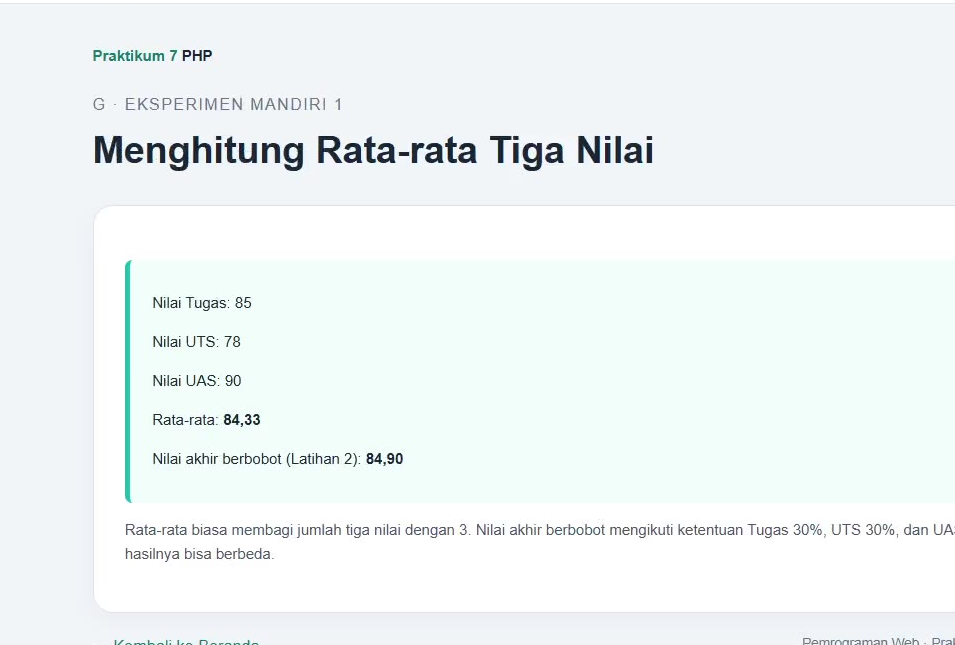

### G.2 — Mencari nama dari array dengan GET

Latihan GET saya kembangkan melalui [`eksperimen/get_cari_nama.php`](eksperimen/get_cari_nama.php). Kata yang ditulis pengguna dicocokkan dengan nama pada array. Pencarian memakai `stripos()` sehingga huruf kapital tidak menjadi pembeda. Sebagai contoh, kata `bima` dapat menemukan **Bima**. Jika tidak ada kecocokan, aplikasi memberi informasi bahwa nama tersebut belum ditemukan.

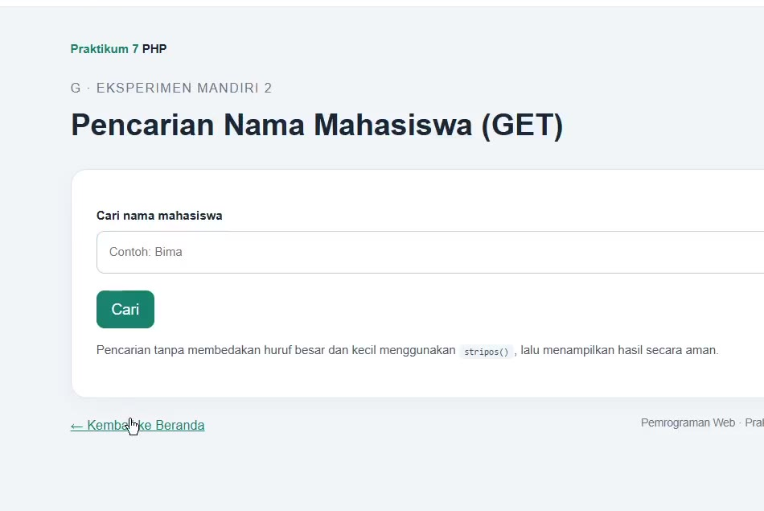

### G.3 — Membuat format angka Rupiah

Melalui [`eksperimen/format_rupiah.php`](eksperimen/format_rupiah.php), saya membuat function `formatRupiah()` untuk menampilkan angka sebagai harga. Function menambahkan awalan `Rp`, menggunakan titik sebagai pemisah ribuan, dan koma sebagai pemisah desimal. Sebagai contoh, `12750.50` ditampilkan menjadi **Rp12.750,50**.

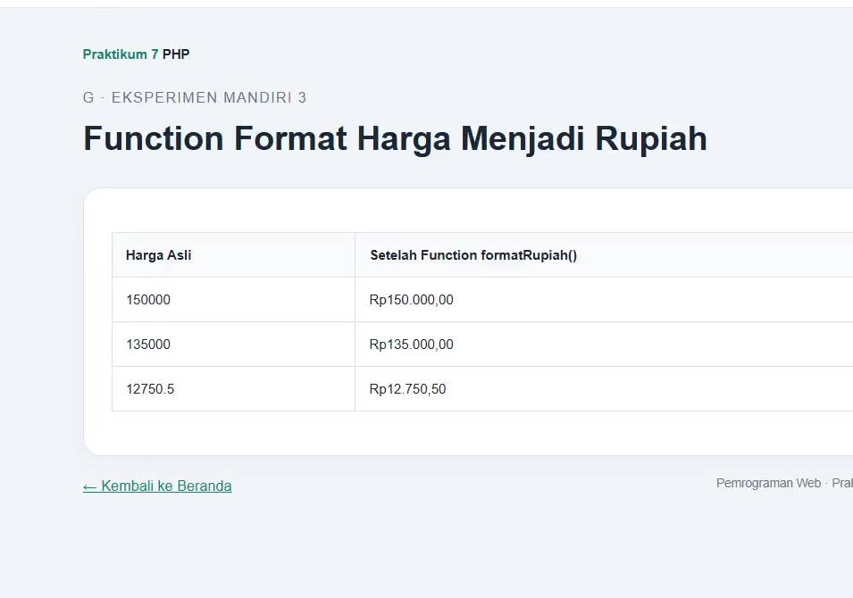

### G.4 — Memvalidasi jumlah digit NIM

Aturan NIM pada mini project bukan hanya pemeriksaan HTML. PHP juga memeriksa bahwa nilai NIM terdiri dari **sembilan digit angka**. Sebagai bukti, masukan `3125ABC` tetap ditolak ketika form dikirim melewati pemeriksaan browser. Dengan begitu, validasi tidak semata-mata bergantung pada atribut form di halaman.

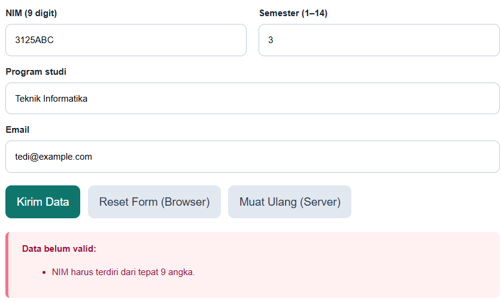

### G.5 — Membandingkan reset browser dan muat ulang server

Form mahasiswa menyediakan dua tombol yang berbeda. **Reset Form (Browser)** mengembalikan kolom ke nilai awal pada halaman yang sedang terbuka, tanpa mengirim permintaan baru. Sementara itu, **Muat Ulang (Server)** membuka halaman lagi menggunakan permintaan GET, sehingga hasil pengiriman POST sebelumnya tidak ditampilkan. Perbedaan tersebut saya amati saat mengganti data untuk beberapa skenario pengujian.

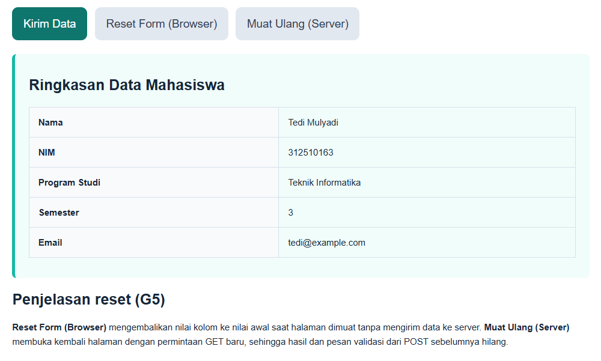

## H. Pertanyaan evaluasi

Jawaban tujuh soal tersedia secara lengkap pada [`JAWABAN_H_EVALUASI.md`](JAWABAN_H_EVALUASI.md). Inti pembahasannya sebagai berikut.

1. **Client-side dan server-side:** proses client-side berlangsung di browser, sedangkan PHP menangani pemrosesan di server.
2. **Menjalankan file PHP:** file perlu dipanggil melalui web server agar perintahnya dapat dieksekusi oleh PHP.
3. **Tanda `$`:** dipakai pada awal nama variabel PHP, misalnya `$nama`.
4. **GET dan POST:** GET menyertakan data pada URL, sedangkan POST mengirimkannya pada body permintaan. POST tidak otomatis mengenkripsi data.
5. **Validasi di server:** aturan browser bisa dilewati, sehingga PHP tetap harus memeriksa masukan.
6. **`htmlspecialchars()`:** mengubah karakter khusus HTML agar input dapat ditampilkan sebagai teks dengan lebih aman.
7. **Function:** mengelompokkan proses yang dapat digunakan berulang, misalnya menghitung diskon atau mengatur format harga.

## I. Hasil pengujian, dokumentasi, dan pengumpulan

Dua pengujian data valid memperlihatkan bahwa form mahasiswa dapat memproses dan menampilkan seluruh informasi yang diisi. Dua kasus tidak valid membuktikan bahwa server mampu menolak NIM yang keliru serta semester dan email yang tidak sesuai. Pada percobaan awal, browser sudah menampilkan peringatan; pengujian lanjutan mengirim form langsung agar pesan validasi dari PHP dapat diamati.

| Skenario | Data yang diuji | Hasil yang diperoleh |
|---|---|---|
| Valid 1 | NIM `312510163`, semester 3 | Data Tedi Mulyadi tampil di ringkasan |
| Valid 2 | NIM `123456789`, semester 4 | Data Siti Aminah tampil di ringkasan |
| Tidak valid 1 | NIM `3125ABC` | PHP menolak format NIM |
| Tidak valid 2 | Semester `15`, email `salah-email` | PHP menampilkan dua pesan kesalahan |

Sebagai pembanding, gambar berikut memperlihatkan peringatan batas semester yang muncul dari browser sebelum pengiriman dilakukan ke PHP.

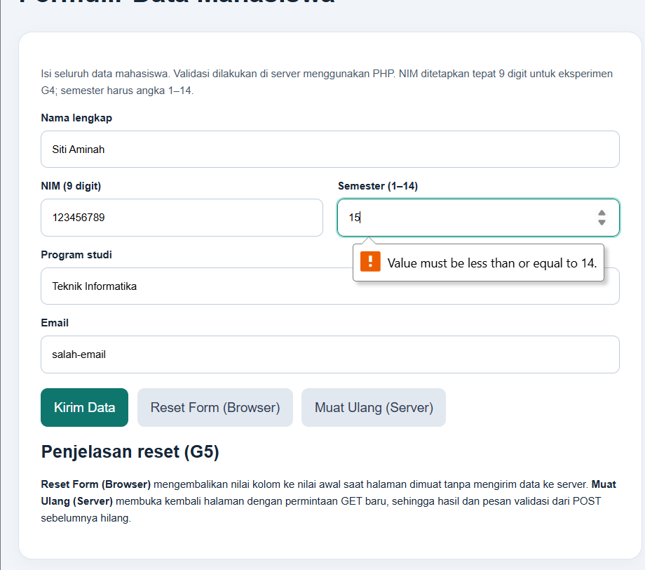

Seluruh dokumentasi ditempatkan pada folder [`screenshots/`](screenshots/). Gambar **E.1–E.7** dan **G.1–G.3** diambil dari rekaman layar saat halaman praktikum dibuka, sehingga gambar tersebut menjadi bukti tampilan aplikasi. Gambar mini project serta pesan validasinya berasal dari screenshot pengujian langsung. Laporan Word dengan cover dan gambar pendukung disertakan dalam file [`Laporan_Praktikum_7_PHP_Tedi_Mulyadi.docx`](Laporan_Praktikum_7_PHP_Tedi_Mulyadi.docx).

Setelah semua berkas siap, folder `Lab7Web_PHP` dapat dimasukkan ke repository GitHub sesuai petunjuk dosen. Alamat repository dicantumkan setelah benar-benar berhasil dibuat dan diunggah.

## Kesimpulan

Melalui Praktikum 7, saya dapat melihat hubungan antara form pada browser dan proses yang dilakukan PHP di server. Materi variabel, percabangan, array, perulangan, dan function membantu menyelesaikan pengolahan data sederhana, sedangkan GET dan POST memperlihatkan dua cara pengiriman masukan. Bagian mini project menjadi latihan yang paling lengkap karena menggabungkan penerimaan data, validasi, dan penyajian hasil. Dari pengujian tersebut, saya memahami bahwa pemeriksaan browser mempermudah pengisian form, tetapi keputusan menerima atau menolak data tetap harus diperiksa kembali di server.
